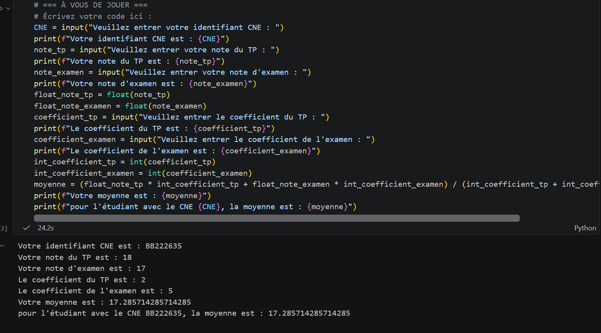
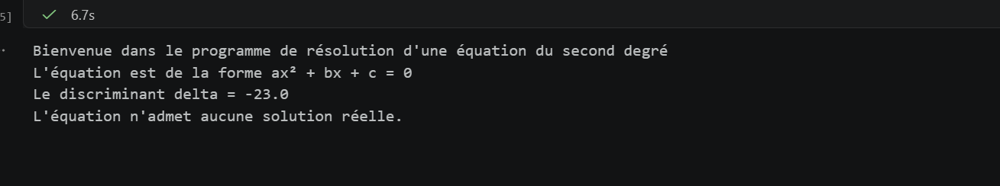
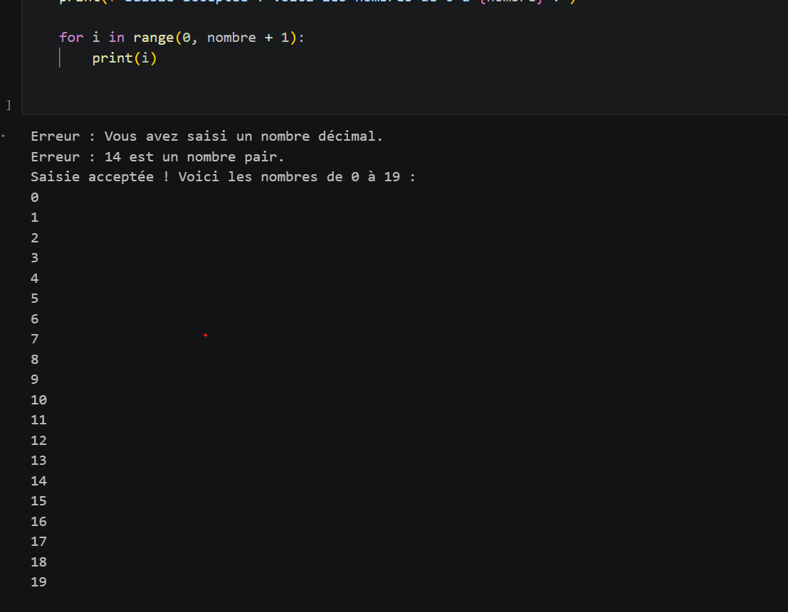
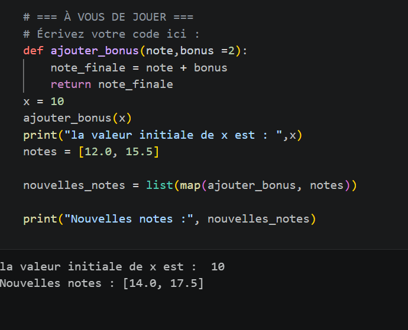
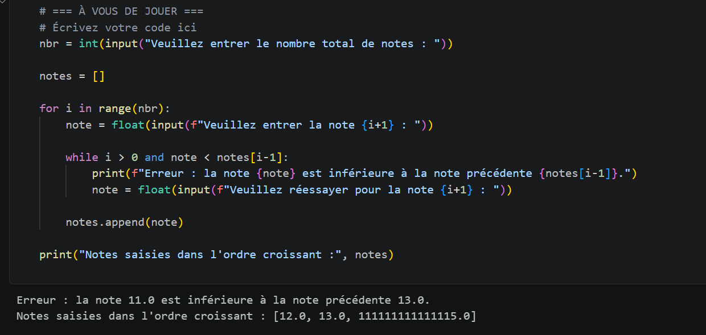
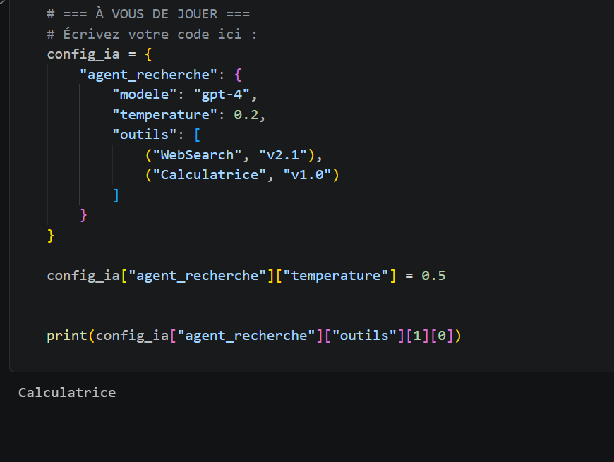

# TP Python - Programmation

## Description
Ce projet regroupe les exercices réalisés dans le cadre
du TP de programmation Python.

## Exercice 1 : Traitement des notes

### Résultat d'exécution

